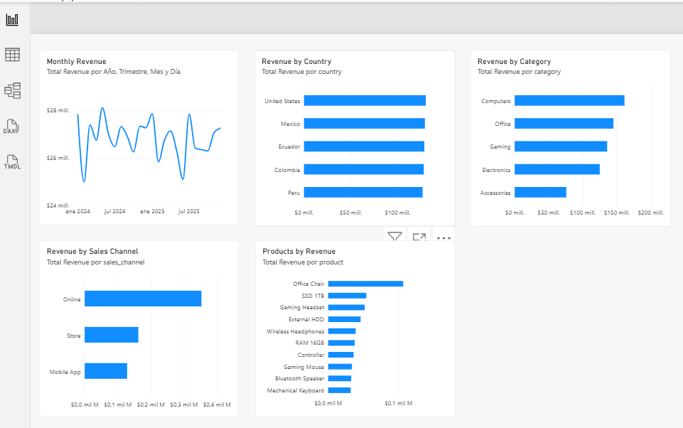
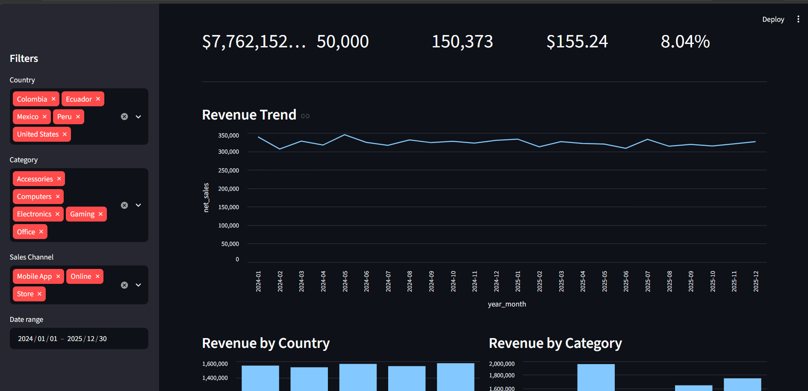
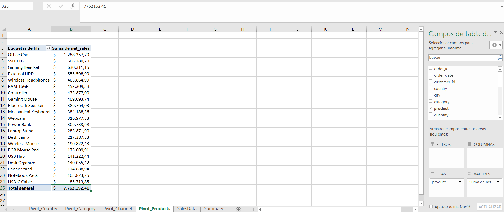
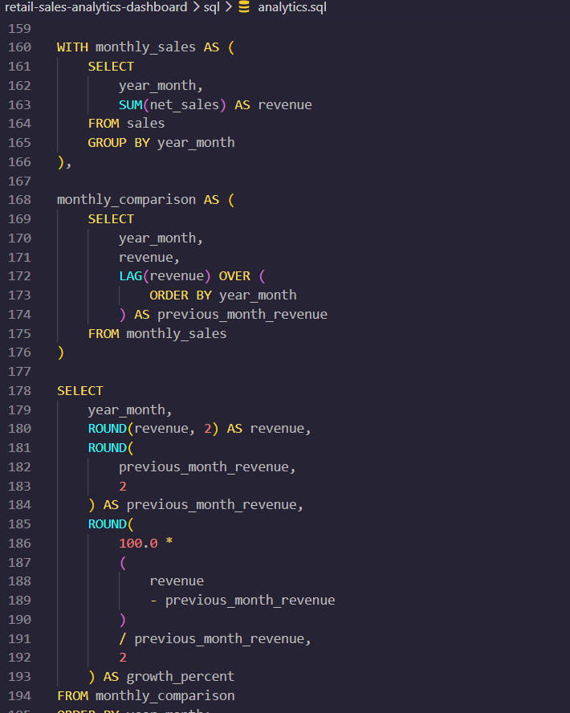

# Retail Sales Analytics Dashboard

End-to-end retail analytics project built with Python, SQL, Excel, Power BI, and Streamlit.

The project demonstrates a complete analytics workflow: synthetic data generation, data cleaning, quality validation, SQL analysis, exploratory data analysis, KPI calculation, visualization, business intelligence reporting, and interactive dashboards.

## Project Workflow

```text
Synthetic Raw Data
        ↓
Data Cleaning
        ↓
Data Quality Validation
        ↓
SQLite Database
        ↓
SQL Analytics
        ↓
Python EDA & KPIs
        ↓
Excel Analysis
        ↓
Power BI Dashboard
        ↓
Streamlit Dashboard
```

## Features

- Synthetic retail dataset with approximately 50,000 records
- Intentional data-quality issues for cleaning practice
- Data cleaning with Pandas
- Data quality reporting
- Feature engineering
- SQLite database integration
- Advanced SQL analytics
- KPI analysis
- Exploratory data analysis
- Matplotlib visualizations
- Excel pivot-table analysis
- Power BI dashboard
- Interactive Streamlit dashboard
- Automated tests

## Technologies

### Data Analysis

- Python
- Pandas
- NumPy

### Database & SQL

- SQLite
- SQL
- Window functions
- CTEs
- CASE expressions
- Aggregations

### Business Intelligence

- Microsoft Excel
- Power BI
- DAX
- Streamlit

### Visualization

- Matplotlib
- Power BI
- Streamlit

### Testing & Development

- Pytest
- Git
- GitHub

## Project Structure

```text
retail-sales-analytics-dashboard/
├── dashboard/
│   └── app.py
├── data/
│   ├── raw/
│   ├── processed/
│   └── retail_sales.db
├── docs/
│   └── screenshots/
├── excel/
│   └── retail_sales_analysis.xlsx
├── notebooks/
├── powerbi/
│   ├── retail_sales_bi.csv
│   └── retail_sales_dashboard.pbix
├── reports/
├── sql/
│   └── analytics.sql
├── src/
├── tests/
├── .gitignore
├── README.md
└── requirements.txt
```

## Data Pipeline

The project generates a synthetic retail dataset and introduces realistic data-quality issues such as duplicates and missing values.

The cleaning pipeline:

- Removes duplicate records
- Standardizes categorical fields
- Handles missing values
- Converts date and numeric columns
- Validates cleaned data
- Calculates gross sales
- Calculates discounts
- Calculates net sales
- Generates time-based features

## SQL Analytics

The SQL layer demonstrates:

- `SUM`
- `AVG`
- `COUNT`
- `GROUP BY`
- `CASE`
- Common Table Expressions
- `RANK`
- `LAG`
- Window functions
- Month-over-month analysis
- Category contribution analysis

## Excel Analysis

The Excel workbook contains the cleaned dataset and pivot-table analysis including:

- Revenue by country
- Revenue by category
- Revenue by sales channel
- Product performance
- Summary metrics

## Power BI Dashboard

The Power BI dashboard includes:

- Total Revenue
- Total Orders
- Units Sold
- Average Order Value
- Return Rate
- Monthly Revenue
- Revenue by Country
- Revenue by Category
- Revenue by Sales Channel
- Top Products
- Interactive filters

## Streamlit Dashboard

The Streamlit application provides interactive filtering by:

- Country
- Category
- Sales channel
- Date

It also displays KPIs, revenue trends, product performance, customer analysis, ratings, and returns.

## Screenshots

### Power BI Dashboard



### Streamlit Dashboard



### Excel Analysis



### SQL Analysis



## Running the Project

Create and activate a virtual environment and install dependencies:

```bash
python -m pip install -r requirements.txt
```

Run the automated tests:

```bash
python -m pytest
```

Run the Streamlit dashboard:

```bash
python -m streamlit run dashboard/app.py
```

## Business Intelligence Exports

Generate the Excel and Power BI datasets with:

```bash
python src/export_for_bi.py
```

This generates:

```text
excel/retail_sales_analysis.xlsx
powerbi/retail_sales_bi.csv
```

## Testing

The project includes tests for:

- Data cleaning
- Database integration
- Dashboard functionality

## Future Improvements

Possible future additions include:

- Azure storage or analytics services
- Automated BI refresh pipelines
- Cloud deployment
- Additional DAX measures
- Forecasting
- Customer segmentation
- Real-world external datasets

## Project Status

Version 1.0.0 represents the first complete portfolio-ready release of the Retail Sales Analytics Dashboard.